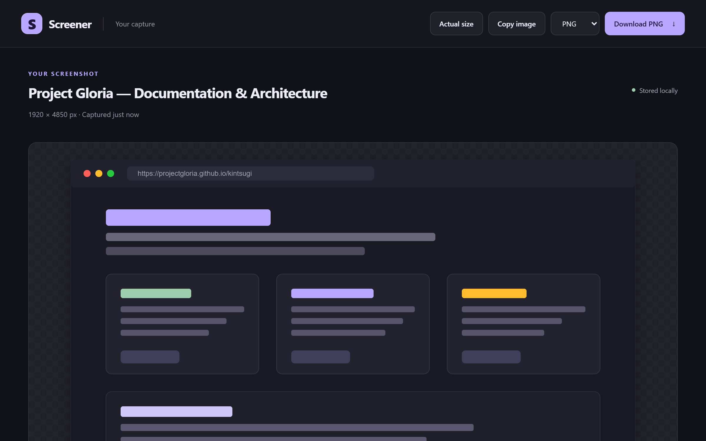
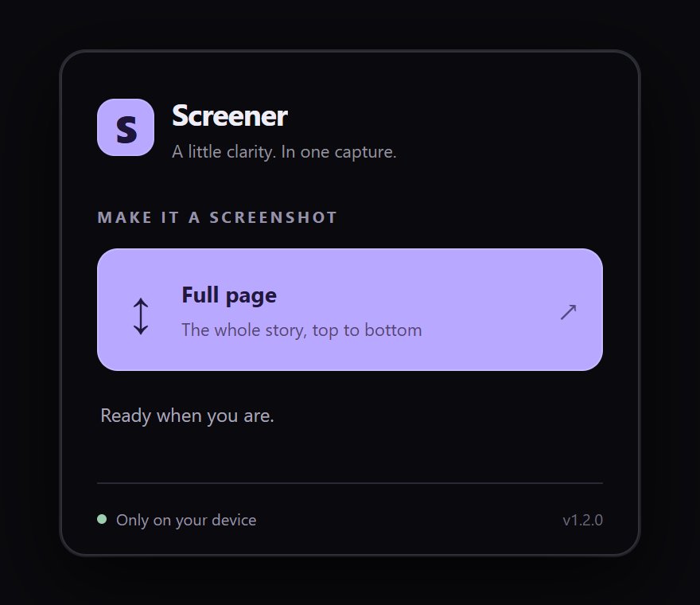
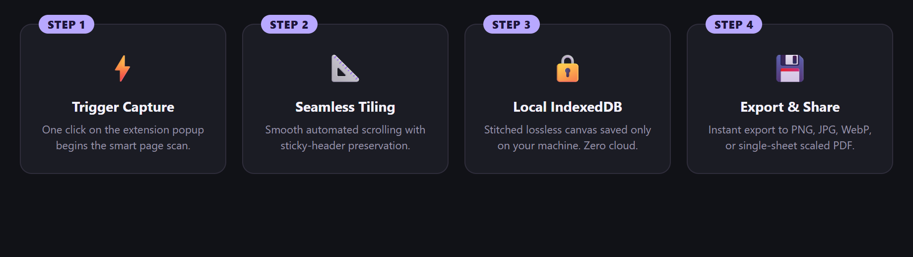
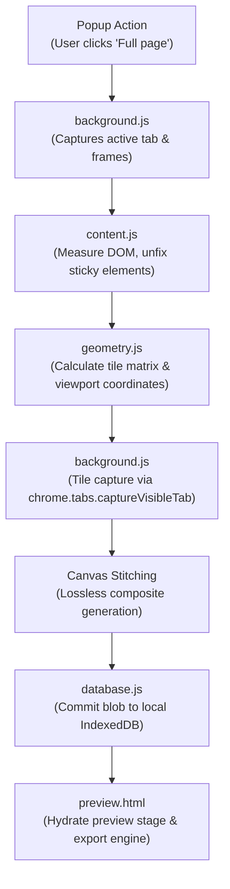

<div align="center">


# Screener

**Capture full pages. Preview and download locally as PNG, JPG, WebP, or PDF.**

*A little clarity. In one capture — lightweight, fast, and 100% privacy-first.*

<p>
  
  
  
  
  
  <a href="LICENSE"></a>
</p>

---

<p>
  <a href="#-about-screener">About</a> •
  <a href="#-key-features">Features</a> •
  <a href="#-visual-tour">Visual Tour</a> •
  <a href="#-how-it-works">How It Works</a> •
  <a href="#-installation--usage">Installation</a> •
  <a href="#-export-formats">Export Formats</a> •
  <a href="#-architecture">Architecture</a> •
  <a href="#-icon--design-philosophy">Design</a> •
  <a href="#-testing--verification">Testing</a> •
  <a href="#-license--credits">License</a>
</p>

<picture>
  
</picture>

</div>

---

## 📸 About Screener

Most webpage screenshot extensions are bloated, demand invasive browser permissions, or silently upload your captures to remote third-party servers.

**Screener** is a focused, privacy-first Chrome extension engineered to produce pristine, seamless full-page captures of modern web pages without a single byte leaving your device.

- 🔒 **100% Local & Private**: No cloud uploads, no account registration, and zero telemetry pings. All captures are stitched in an offscreen canvas and stored directly in your browser's private IndexedDB database.
- 📐 **Intelligent Stitching Engine**: Handles sticky headers, fixed navigation banners, nested scroll containers, and dynamic layouts without ugly duplicated headers or stitching seams.
- ⚡ **Modern Manifest V3 Architecture**: Powered by lightweight service workers and asynchronous message passing for instant responsiveness and negligible memory footprint.
- 💾 **Versatile Local Export**: Instant export to PNG (lossless), JPG, modern WebP, or proportionally scaled single-sheet PDF.

---

## ✨ Key Features

<table>
  <tr>
    <td width="50%">
      <h3>📜 Full-Page Seamless Capture</h3>
      <p>Scrolls and captures full vertical heights, handling dynamic document dimensions, heavy media layouts, and infinite-scrolling pages effortlessly.</p>
    </td>
    <td width="50%">
      <h3>📌 Smart Sticky-Element Unfixing</h3>
      <p>Automatically identifies and temporarily isolates <code>position: sticky</code> and <code>fixed</code> elements during stitching to avoid duplicated visual artifacts across tiles.</p>
    </td>
  </tr>
  <tr>
    <td width="50%">
      <h3>📄 Single-Sheet Scaled PDF</h3>
      <p>Exports complete webpage captures into a continuous single-page PDF document sized proportionally to your capture without awkward page breaks or clipped graphics.</p>
    </td>
    <td width="50%">
      <h3>🖼️ Multi-Format Conversion</h3>
      <p>Switch seamlessly between lossless <b>PNG</b>, compressed <b>JPG</b>, next-generation <b>WebP</b>, or binary <b>PDF</b> directly in the preview stage.</p>
    </td>
  </tr>
  <tr>
    <td width="50%">
      <h3>📋 Direct Clipboard &amp; Zoom</h3>
      <p>Copy captured images straight to your operating system clipboard with a single click, or toggle 1:1 pixel inspection zoom to verify capture fidelity.</p>
    </td>
    <td width="50%">
      <h3>🧹 Automatic Local Lifecycle</h3>
      <p>Captures reside in local IndexedDB for instant reload and preview, with an automated 24-hour cleanup cycle to keep your disk lean and tidy.</p>
    </td>
  </tr>
</table>

---

## 📸 Visual Tour

### 1. Fast &amp; Focused Popup
Launch a full-page capture with a single click. The minimal popup displays live progress feedback and an instant cancel option if needed.

<p align="center">
  
</p>

### 2. Dedicated Preview &amp; Export Stage
Every capture opens immediately in a clean, dark-themed preview dashboard where you can inspect dimensions, toggle actual-size zoom, copy to clipboard, or choose your download format.

<p align="center">
  
</p>

### 3. Transparent Four-Step Workflow
From your trigger click to local disk export, the entire capture lifecycle executes securely within your browser sandbox.

<p align="center">
  
</p>

---

## ⚙️ How It Works

Screener executes a coordinated pipeline between the popup, background service worker, page content script, and an isolated preview tab:



1. **Measurement & Layout Preparation**: `content.js` inspects document root and nested scrollers, temporarily setting `position: relative` on sticky headers and pre-loading background assets.
2. **Synchronized Tiling**: The background worker steps through the calculated coordinates from `geometry.js`, capturing each viewport tile and stitching it onto an internal `OffscreenCanvas`.
3. **DOM Restoration**: As soon as the final tile is recorded, the page DOM and scroll positions are restored to their original state.
4. **Local Persistence**: The final stitched PNG blob is saved into local `IndexedDB` under an isolated capture ID.
5. **Preview & Export**: Screener opens `preview.html?id=...`, providing zero-latency inspection and format transformation using `export.js`.

---

## 🚀 Installation &amp; Usage

### Load into Chromium Browsers
Screener runs on **Google Chrome**, **Brave**, **Microsoft Edge**, **Arc**, **Vivaldi**, and any Chromium-based browser supporting Manifest V3 (Chrome 109+).

1. **Clone or Download the Repository**:
   ```bash
   git clone https://github.com/projectGloria/Screener.git
   ```

2. **Open Extensions Management**:
   - In Chrome or Brave: Navigate to `chrome://extensions`
   - In Microsoft Edge: Navigate to `edge://extensions`

3. **Enable Developer Mode**:
   Toggle the **Developer mode** switch in the top-right corner.

4. **Load Unpacked**:
   Click **Load unpacked** and select the `Screener` project root directory.

5. **Pin and Capture**:
   Pin Screener to your browser toolbar, open any webpage, and click **Full page**.

---

## 📦 Export Formats

| Format | MIME Type | Alpha / Transparency | Best For | Output Pipeline |
| :--- | :--- | :---: | :--- | :--- |
| **PNG** | `image/png` | ✅ Yes | Crisp screenshots, UI designs, code snippets, documentation | Direct lossless canvas capture |
| **JPG** | `image/jpeg` | ❌ No | Photography-heavy pages, compact sharing, small file size | `OffscreenCanvas` with white backdrop |
| **WebP** | `image/webp` | ✅ Yes | Modern web publishing, high compression ratio | Browser-native WebP canvas encoder |
| **PDF** | `application/pdf` | ❌ No | Archiving, printing, single-page presentation | Custom single-sheet PDF binary generator |

> [!NOTE]
> Screener's PDF generator scales the entire screenshot into a single continuous PDF page box (`MediaBox`), completely eliminating accidental page cutoffs in the middle of text paragraphs or images.

---

## 🏗️ Architecture

```
Screener/
├── manifest.json         # Manifest V3 extension configuration & permissions
├── background.js         # Service worker: capture coordination & tile stitching
├── content.js            # Injected script: DOM inspection, scrolling & unfixing
├── geometry.js           # Tile coordinates, overlap & layout calculations
├── database.js           # IndexedDB abstraction & 24-hour cleanup lifecycle
├── export.js             # Multi-format conversion & single-page PDF encoder
├── popup.html / .js      # Minimalist trigger popup with progress indicator
├── preview.html / .js    # Standalone capture preview stage & action toolbar
├── styles.css            # Dark aesthetic styling with lavender accent
├── progress.css          # Fluid capture progress bar animation
├── icons/                # High-contrast application icon suite (16px, 48px, 128px)
├── assets/               # Visual tour and documentation previews
└── tests/                # Automated Playwright & Sharp test suites
```

---

## 🎨 Icon &amp; Design Philosophy

<p align="center">
  
</p>

> *"Clarity over clutter: calm dark tones, subtle lavender accents, and instant visual feedback."*

- **Bespoke Palette**: Crafted with an obsidian dark theme (`#111217`), deep charcoal cards (`#1b1c24`), and soft lavender highlights (`#b8a8ff`).
- **Quiet Interface**: The popup and preview remain unobtrusive, keeping the focus entirely on your captured content.
- **Accessible Typography**: High-contrast labels, clear keyboard focus indicators, and semantic status announcements.

---

## 🧪 Testing &amp; Verification

Screener includes comprehensive end-to-end integration and defect verification suites utilizing **Playwright** and **Sharp**:

```powershell
# Set Node and Chromium environment paths
$env:NODE_PATH='path/to/node_modules'
$env:SCREENER_CHROMIUM_PATH='C:\Program Files\Google\Chrome\Application\chrome.exe'

# Run sticky and nested scroller capture tests
node tests\capture-sticky.cjs

# Run multi-format export and PDF validation tests
node tests\exports.cjs

# Run audit harness verification
node audit\verify.cjs
```

---

## 🛡️ Privacy Guarantee

Screener was built from day one on an uncompromising privacy foundation:

- **No Remote Network Requests**: The extension never transmits image data, page URLs, titles, or browsing activity over the internet.
- **Zero Third-Party SDKs**: No Google Analytics, no tracking pixels, and no external CDN dependencies.
- **Local Storage Isolation**: All captures exist exclusively in your browser's local `IndexedDB` sandbox and are never shared across profiles.

---

## 📜 License &amp; Credits

Screener is part of **[Project Gloria](https://github.com/projectGloria)**, released under the **[MIT License](LICENSE)**.

- **Author**: Project Gloria & community contributors.
- **Copyright**: &copy; 2026 Project Gloria.
- **License**: See the [LICENSE](LICENSE) file for complete terms.
